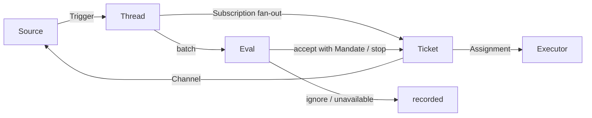

# dsh-superagent

DeepSeek 团队公开的研究原型：绑定**一个 GitHub 仓库**的主动式编码 Agent，作为 [DeepSeek Harness](https://www.deepseek.com/en/harness/) 的 bundle 运行。它监听 GitHub，可选监听飞书；被允许的人提出请求后，它开一张工单，在独立的 Agent Session 和目录里做完，再回到原对话交付结果（例如一个 pull request）。Web 面板只把「需要人处理」的事项摆到前面。

仓库声明：这是日常开发里长出来的研究代码，大量工程由编码 Agent 完成，**不是 DeepSeek 官方产品，也不是生产就绪软件**。公开发布时做过改编，因此与内部版本、以及文章 *Exploring Super-agent Design: Towards a More Autonomous Agent System* 里描述的实现都不完全相同；文中有些设计仍是未来方向，原型里没有实现。许可为 MIT。语言是 TypeScript，`pnpm check` 跑类型检查、测试和构建。

## 核心概念

- **注意力预算**：每条消息、通知、提问、设置、面板元素和文档段落都在花人的注意力，给不出更多价值就删掉。原则是：尽量少占人的注意力，尽量多给出可用结果。
- **只在被请求或成文规则允许时行动**：请求必须直接叫到 Agent，且来自允许名单上的人，或来自团队对请求开放的会话。没人点名的工作要有团队写好的规则，并且默认先记成「本来会做什么」，不真正接单。
- **只在人必须行动或能用上结果时开口**：确认一次并说清要做什么，干活时保持安静；结果就绪、需要决定、或做不完时才再写。一次只问一个具体问题，而且用结构化字段，避免问题埋在长报告里。
- **按影响停，不按工时停**：本地改动能做到可审查的结果；需要设计决定的改动停在一个清楚的问题上。草稿标未完成，失败报失败，不为了少问人而绕过限制。
- **领域只有少数概念**：Source、Trigger、Thread、Eval、Mandate、Ticket、Assignment、Subscription、Channel、Policy。业务需求变成其中某个概念的属性，或 Agent 要遵守的 prompt，而不是再发明一个名词。人不是领域实体：触发器带着来源给出的身份；跨来源的「这是同一个人」写在 prompt 里。

## 工作怎么流过系统

Source 产出不可变的 Trigger。Trigger 归入一条或多条 Thread（时间有序的事件流）。人的消息若已经扇出到某张 Ticket，就留在那张工单上，不再评估；其余 Trigger 进入 Eval。Eval 分两层：确定性的 **gate（准入）**，以及模型做的 **assessment（研判）**。接受则创建带 Mandate 的 Ticket，再由 Assignment 交给 Executor。结果经 Channel 写回来源（飞书话题回复、GitHub 评论、review thread 回复）。

| 概念 | 它守住的规则 |
|------|----------------|
| Source | 记住读位置和自己的 bot 身份；丢掉 bot 自己的消息和监听范围外的事件；重启不能重放。本仓库实现飞书（实时事件、历史恢复、订阅话题轮询）和 GitHub（通知、订阅的 Issue/PR、CI、合并/关闭；开关打开后也可收仓库内每条新 Issue、PR、评论和默认分支 CI） |
| Trigger | 审计与幂等的单位。同一个 Trigger 接受两次只产生一张 Ticket |
| Thread | 同一时刻最多一次 Eval；可挂多张 Ticket；持有 Subscription、进行中的 Eval 和 Decision 历史 |
| Correlation | 同一 Trigger 所属 Thread 之间的关系，只补充上下文，不负责路由 |
| Channel | Thread 的写侧。确认、回复、pull request、已解决的 review 都是写 |
| Policy | 带版本的研判规则，加上每个 Source 自己的部分：谁可以用该来源的身份发起工作、名单如何同步、哪些 bot 可以成为候选。不同来源的身份永不互相映射 |
| Eval | 无状态。输入是一批 Trigger、Thread 快照、该 Thread 上包括已结束在内的全部 Ticket、以及当前 Policy。输出 Decision：`accept` / `stop` / `ignore` / `unavailable` |
| Mandate | 一次接受所授予的东西：Policy 版本、范围、强度、命中的规则、发送者在该来源上的身份、来源如何收到这条 Trigger。不可变；范围变宽就要新 Ticket。工单结束不结束授权；只有人的 stop 撤回它，或恢复前复验失败才撤销它 |
| Ticket | 唯一由 Eval 创建的授权工作单元。状态自己定义（open ↔ ended），不跟随 Executor 的 Session。人在其 Thread 上的消息可以把它从 ended 拉回 open，除非人已经 stop |
| Assignment | Ticket 与一个 Executor 实例的绑定，生命周期 pending → running → ended，与 Ticket 独立。只有最终报告才能从 Executor 一侧结束 Ticket |
| Subscription | Ticket 与 Thread 的多对多，挂在 Thread 上。匹配的 Trigger 扇出到每张仍存活的订阅工单，不检查是谁发的，也不再走 Eval。仅供上下文的 Thread 不授予权力，也不唤醒已结束的工单 |

Executor（Session 和目录）在领域之外，通过 Assignment 接进来。主 Session 在代码和 prompt 里叫 `orchestrator`，只做路由；每张 Ticket 的 Executor Session 叫 `worker`。

## 授权

宿主用代码执行允许名单、规则和 Mandate。消息、评论和引用的文档只是决策的输入，改不了这些权限。Prompt 同样改不了 gate、Mandate、工具检查和账号包装。

### 两条路径

**Eval：要不要开工。** Source 记下这条消息是否在叫 Agent：`mention`（点名 bot 或 Agent 账号）或 `direct`（私聊）。

- 名单上的人点名 Agent → 明确请求（explicit）。
- 不在名单上、也没点名的人，以及「收到全部消息」的范围，走准入表。
- 在 bot 名单上的 bot 只能产生推断候选（inferred），永远不能发明确请求，也不能 stop。普通账号的自动审查者在宿主眼里仍是人，要在团队 prompt 里点明它们是自动化审查。

**Subscription：已有工作怎么继续。** 订阅 Thread 上的每条消息（含 bot 和 CI）都作为上下文送到工单，绕过 gate，不授予新权力。工单仍受自己的 Mandate 限制。Executor 处理范围内的后续，超出范围或属于另一张工单的，交还一次；当没有任何工单再拥有这条消息时，它才带着各 Executor 的理由进入新的 Eval。

### 强度与接受模式

| 强度 | 典型情况 |
|------|----------|
| explicit | 名单上的人点名；或在已有 Ticket 的 Thread 上跟进；或准入表该格设为明确请求 |
| inferred | 不在名单上的人在已有 Ticket 的 Thread 上跟进；准入表设为推断候选；bot 名单上的 bot 点名，或发在「收取全部消息」的范围里 |
| not admitted | 其他 bot、准入表忽略的一切、以及接受模式为 `off` 时的全部推断情形 |

接受模式是 Policy 的一部分，明确请求在三种模式下都有效：

| 模式 | 效果 |
|------|------|
| `off` | 任何推断都不成为候选 |
| `observe`（默认） | 推断候选仍被研判；正向结果记成 ignore，并标上 “would accept”，不真正接单 |
| `auto` | 推断候选的正向研判会接单。主动接单至少要命中一条启用的规则 |

建议从短允许名单加 `observe` 开始，看记录下来的 Decision 像样之后，再放宽名单、再切到 `auto`。

每条规则描述一类主动工作。命中的规则名和说明会交给 Executor；该规则的流程和沟通要求只覆盖这一张 Ticket，压过默认。适用于所有工单的要求写在团队 prompt 里。推断工单的 Executor 还会收到一条收尾说明，把工作限制在命中的规则内。

### Policy 版本、恢复与停止

规则、接受模式和各 Source 的 Policy 部分一起哈希成 Policy 版本，每份 Mandate 都记下它。版本变化会丢掉正在跑的 Eval 并重新排队，同时给受影响的存活 Ticket 送一条 policy-changed Input（规则变了、请求者不能再开工、或不再接受主动工作）。**不立刻撤销仍在进行的 Mandate**，避免半成品被取消。

已结束的 Ticket 保留 Mandate。人在它自己的 Thread 上发消息可以不经新 Eval 就恢复同一项工作；bot 和 CI 唤不醒它。恢复前按授权基础复验：推断授权需要仍处在 `auto` 且命中规则仍启用；按准入表进来的，今天的表和成员身份仍要给出至少原来的强度；bot 授权要求该 bot 仍在名单上。复验失败则工单保持结束，等待中的消息改走 Eval。

改变 Mandate 的操作只有三个：accept 创建它，人的 stop 撤回它，复验失败撤销它。Thread 里说 “stop” 是普通 Trigger，由 Eval 决定；面板上的 Stop 是直接作用在 Ticket 上的命令。Executor 不能自行宣布「有人让我停」。

Eval 有时限，从候选送到主 Session 起算，送达前的等待不计。超时把 Trigger 重新排队；连续两次重试后再超时，第三次记 `unavailable`。面板只在这条 unavailable 不到 24 小时、仍是该 Thread 最新 Decision、未被忽略、且 Thread 不在排队或评估中时，才要求人处理。

## 执行

每张开放 Ticket 有一个阶段，从上到下第一条命中的为准：

| 阶段 | 条件 | 面板 |
|------|------|------|
| person / delivery | 把 Input 送到 Executor Session 失败 | Input undelivered |
| person / answer | 有一条 Attention（等人回答的结构化问题） | Awaiting answer |
| person / review | 最新 Report 是 `ready` | Awaiting review |
| person / blocked, failed | 最新 Report 是 `blocked` 或 `failed`，且此后没有人的消息 | Blocked · Failed |
| working / queued | 没有 Assignment，或 Assignment 还在 pending | Queued |
| idle | 最新 Report 是 `waiting`，或 Assignment 已结束 | Waiting for a Trigger |
| working | 其余 | Working |

`person` 阶段表示没有人的输入就进行不下去。新的人的消息会把 blocked/failed 重新交给 Executor。

每张 Ticket 得到名为 `worker-<id>` 的 Executor Session，以及按工单短名命名的目录，默认在执行根目录的 `work/` 下。Executor 以操作者的 OS 用户身份跑命令，不需要批准。`dsh-superagent-worker` 预设在 5 秒后把前台 shell 转成后台作业，这样长命令不会挡住下一条消息。主 Session 用更小的 `dsh-superagent-router` 预设，同样限制 shell 与 job 等待。Worker 的 subagent 用 DeepSeek Harness 的 `standard` 预设（shell 60 秒后转后台），工单结束时丢掉工作工具。

并发上限作用在 worker slot 上，另外给人的消息或状态查询留一个额外槽，并且这种唤醒优先于新的开工，避免新工作把人挡在已有工单外面。CI 等其他 Input 只能等普通槽。

第一次 Assignment 之前，若目录不存在，prepare 命令在执行根目录用 `sh` 跑一次，限时十分钟。典型写法是 `git worktree` 做出一份检出。失败则工单失败并记下输出；重试或人的消息会再准备一次。分支路径最后一段与工单短名一致的 pull request 属于这张工单。

执行变量（目录、短名、Ticket id、禁止命令、GitHub 仓库与 Agent 账号、飞书 bot 与会话等）同时给 prepare 命令和 Executor 说明，**不含凭据**。Worker 用 Agent 账号的 `gh` 访问 GitHub，用 bot 的 `lark-cli` 访问飞书。这些包装和目录是默认值，不是安全边界：Worker 仍可用绝对路径执行程序。只有面板能改执行环境；发给主 Session 的文字改不了配置好的 shell 命令。

### 合并与结束

自动合并由 **Delivery requirements** 这段 prompt 管，宿主没有专门的合并决策逻辑。默认 Executor 从不以免责的 Agent 账号打开 auto-merge（GitHub 会把合并算到打开它的人身上）；要合并就得在交付要求里写另一个账号的 CLI，否则由人来合并。默认说明还要求：这是为本工单开的 PR、已经就绪、必需的批准覆盖了 head commit、增删合计少于 200 行；再推一版之前先撤回 auto-merge。这些是对 Agent 的指示，GitHub 分支保护才是真正的强制。

Report 的取值：`progress`、`waiting`、`ready`、`blocked`、`failed`、`dropped`。

- 没有 pull request 的 `ready`：工单以完成结束。
- 没什么要人做的（复现不了、或已被取代）：报 `dropped`，工单结束且默认不发消息；人之后的消息仍可恢复它。
- 有 pull request：工单跟住它开出来的、以及从它的分支开出并被报告或被 GitHub Source 发现的 PR。当它开出的 PR 都不再开放（若一个都没开，则它跟随的 PR 全部关闭）时结束，结果取最后一次相关关闭，并保留 Subscription，使人的后续评论还能恢复。聊天 Channel 收到一条最终通知；GitHub 上 PR 自己已经显示结果。

回合结束时若还有 shell job 或 subagent，工单占着 worker slot，不报 waiting。后台工作最多再给 30 分钟，到点杀掉 shell job 并报 waiting；subagent 可以继续。交给人（`ready`、提问、`blocked`、`failed`）会立刻释放 slot。交接时 subagent 停止，供审查用的服务器一类 shell 可以留到 Assignment 结束，且不受 30 分钟限制。

### 失败、恢复与外发

模型供应商或网络的瞬时失败（HTTP 408、429、5xx，以及连接被拒、重置、超时）先重试三次，退避加长。prepare 失败不自动重试。一旦失败，CI 和 bot 消息只记录、不投递、不唤醒；工具仍可用，人可以直接在 Session 里继续。Retry 结束当前 Assignment，在同一个 Session、目录、分支和 PR 上开一个新的。模型只在创建 Session 时应用，已有 Session 保持原模型。

重启时，正在跑的 Assignment 以 “host restarted” 结束，新的 Assignment 带着恢复说明开工：先看目录、git 历史和 GitHub，再重复任何对外动作，最老的 Ticket 优先。Session、目录、Subscription、待处理消息，以及「哪条消息已被 Session 读入历史」都会留下来。

决定之后要做的事（把候选、跟进或报告转给主 Session，启动 Assignment，投递 Input）先落库再执行。Effects 队列在事务提交后才跑，同一种 kind/key 只有一行。失败按指数退避重试；连续失败三次才出现在系统问题里。`delivery` 的失败显示在工单上，不进总览。

| Effect | 作用 |
|--------|------|
| `assessment` | 把候选卡片送进主 Session，送达后才开始 Eval 时限 |
| `launch` | 准备目录、Executor Session、开工消息 |
| `delivery` | 按顺序把等待中的 Input 交给正在跑的 Assignment |
| `relay` | 把 worker 的报告、提问或人的跟进送进主 Session，保持顺序 |
| `notice` | 往主 Session 注入通知，不唤醒它 |
| `reply` | 经 Source 把 Channel 消息发出去；同一工单、同一会话按排队顺序，确认在结果之前 |

GitHub Source 对每个 Issue、PR、Thread 单独读；连续三次轮询失败才报 Source 错误，一次成功就清零。404 也会重试（私有仓库丢权限时 GitHub 同样返回 404）。持续读失败的已通知 Issue/PR 在首次失败一天后丢弃，GitHub 报告已删除则立刻丢弃；读位置保持原处，之后的通知或轮询仍能补上漏掉的内容。

发出去的消息在来源关掉时等待，只在来源不再监听该会话、或来源明确说这个会话永远收不到时丢弃（GitHub 上已删除的 Issue 或已锁定的会话；飞书上被撤回或找不到的消息）。丢弃会留下时间和原因，不会再次入队。暂停处理会停掉派发、新 Eval、Eval 超时、Input 投递和回复；来源继续记 Trigger，已经在跑的 Executor 回合不被打断。

## Prompt 与面板

团队可编辑三段，外加 skills，并可覆盖每个内置 system-prompt 片段。工具描述、通知和卡片留在代码里，不能通过 prompt 设置改。

| 团队段落 | 内容 |
|----------|------|
| Communication | 何时给人发消息、消息怎么写、每条 GitHub 消息开头的声明（默认 `This is by an automated agent, not a human`）、如何处理 review、哪些普通账号是审查 bot |
| Ticket scope | 工单何时继续、何时停在草稿 |
| Delivery requirements | PR 里要有的证据、自动合并条件与行数阈值、提交作者 |
| Team skills | 需要时才加载的知识，例如哪个飞书用户对应哪个 GitHub 账号 |

组装顺序：共享说明与角色 → 三段团队文字 → Subscription 与回复 → 主 Session 的派发或 Executor 的工作说明 →（仅主 Session）准入说明 → 交接 → 执行环境 →（仅主 Session）Policy。Policy 段每次模型请求都从设置重新生成，放在最后，这样规则变化不会改动前面的 prompt 文本，有利于缓存。Executor 还读 DeepSeek Harness 的编码 prompt 和仓库的 `AGENTS.md`；主 Session 不读。优先级从强到弱：工具和宿主强制的事实、内置与生成段、主动工单命中规则的流程与沟通、团队段落与 skills、外部文字（消息、评论、文档、引用永远只是数据）。

内置文字把角色拆开：主 Session 只路由，用一次调用处理多个等待中的候选，路由笔记最多 30 个词，不做技术决定；Executor 读原始材料、判断范围、实现并验证。聊天消息默认一句，硬限制 100 词。提问走 Report 里的 `human_action`，主 Session 原样转发。开 PR 不等于就绪；没有真实的改前截图，UI 改动不算 ready。自动审查者每个 PR 最多三个回合。若已有人的分支或 PR 包含了同样的改动，Executor 关掉自己的 PR，用一句话指向对方的。

面板在 DeepSeek Harness Web 侧栏的 **Superagent** 里，按三个问题组织：现在有没有事需要我、系统是否健康且在做对的事、一件工作从 Trigger 到 Eval 到 Ticket 的历史。页签按工作流排：Overview、Source、Trigger、Eval、Execution、Settings。健康状态不占地方；数字只在它会改变监督者的行动时出现。Overview 链到详情页，不自己变成另一份详情。

## 实现骨架

`Runtime`（`src/app/runtime.ts`）是组合根，不含领域规则：锁住状态目录、打开 SQLite Store、组装各部分。`Engine`（`src/core/engine.ts`）是 Trigger、Thread、Decision、Ticket、Assignment 的唯一写入者。所有 Engine 方法同步，每条命令在一个事务里改聚合；端口在事务内把外部工作入队，适配器在提交后执行。`src/core` 除 Node 的哈希外不引用外部模块，也不做 I/O。

Engine 内部分五块，依赖单向：Intake（收下 Trigger、扇出、排队 Eval）和 Evals 都依赖 Tickets；Tickets 依赖 Replies；Assignments 依赖 Tickets 与 Replies；Replies 不依赖其他部分。调用方只能拿到自己角色的方法子集：`EngineForSources`、`EngineForMainSession`、`EngineForPeople`、`EngineForSettings`、`EngineForExecutor`。

设置、prompt 版本、effect 行、outbox 回执、健康项各有唯一写入者。Source 只能经 `SourceContext` 调 Engine 来绑定或关闭 Thread。拒绝一律是带固定 code 的 `UserError`，面板按 code 显示文案。Source 以插件注册（`SourceKind`）：声明身份、配置 schema、Channel、Policy 部分和健康项；加一个来源的步骤写在 `docs/008-cookbook.md`。

安装不手写长步骤：让编码 Agent 读仓库里的 `SETUP.md`，一次问一个短问题，先给出完整计划，再安装和配置。文档按编号顺序读，后一篇只依赖前面已经引入的概念。

## 操作者要承担的责任

Agent 用团队每天看得到的账号评论、开 pull request、给人发消息。能做的越多，操作者对同事的注意就越欠一份小心：从窄的允许名单和只记录的主动工作开始；吵的时候把 prompt 写得更短更严，或直接暂停，而不是再发消息解释噪音；不用它堆 PR、广播和忙碌的无用功；以自己的名义发出去的内容要读，错了就改 prompt。目标是在对的时间给对的帮助，其余时间什么都不做。

## 相关链接

- [[hermes-agent]] — 同样把 Agent 放进团队每天使用的渠道，并强调技能与记忆；Hermes 偏自我改进闭环和多平台网关，dsh-superagent 把「少占注意力」做成授权、扇出和面板的硬规则
- [[design-agent]] — 同属「harness 即产品」：长任务的事件、唤醒、回执和人机交接在代码里，而不靠 prompt 自觉
- [[trellis]] — 团队级编码 Agent 脚手架，把 spec/task 固化进 git；dsh-superagent 把工单、授权和来源事件固化进 SQLite，并由宿主强制执行
- [[pi]] — 极简终端 harness，能力交给扩展；dsh-superagent 是绑在 DeepSeek Harness 上的厚运行时，领域规则在 Engine 里
- [[openspec]] — 仓库内活规格与变更提案；可与「一张 Ticket、一份 Mandate、一个可审查结果」对照
- [[agent-skills]] — 团队 skills 与内置 `skill/github`、`skill/feishu` 的加载方式；权限仍由代码授予，skill 文本改不了 gate
- [[mastra]] — TypeScript Agent 框架里的工作流、HITL 与可观测性，问题域相近，形态是库而不是单仓库值守原型

## 参考

- GitHub: https://github.com/deepseek-ai/dsh-superagent-prototype
- DeepSeek Harness: https://www.deepseek.com/en/harness/
- 设计文章（原型与之并不完全一致）: *Exploring Super-agent Design: Towards a More Autonomous Agent System*
- 文档顺序: `docs/000-philosophy.md` … `docs/008-cookbook.md`
